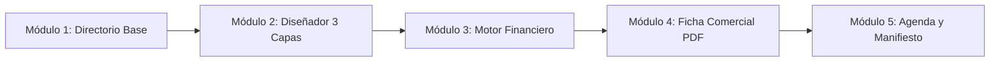

# Especificación Técnica de Arquitectura e Implementación
## Guía de Ingeniería para Desarrollo (DEV Spec)
> **Versión del Documento:** `v2.0` (Core Loop Implementado en Next.js 15)  
> **Última Actualización:** 28 de Noviembre de 2026  
> **Estado:** MVP 100% Funcional en Desarrollo Local (`[DEV] Andrés`)  
> **Fuente Canónica de Negocio:** [`DOCUMENTO_DISENO_PLATAFORMA_GESTION_TURISTICA.md`](file:///c:/Users/ivanc/OneDrive/Desktop/Programación/IA/Proyecto%20Gestor%20de%20Tours%20-%20Antigravity/DOCUMENTO_DISENO_PLATAFORMA_GESTION_TURISTICA.md) (`v2.0`)

---

## 1. Propósito y Audiencia del Documento

Este documento está diseñado **exclusivamente para el equipo de desarrollo e ingeniería (`[DEV] Andrés`)**. Desacopla la visión comercial y regulatoria del documento maestro para concentrarse al 100% en:
- Stack tecnológico, contratos de datos e infraestructura.
- Patrones de diseño de software (App Router, Server Actions, Multi-Tenancy).
- Esquema relacional, migraciones y políticas de índices en PostgreSQL.
- Estrategia de pruebas, integración continua (CI/CD) y despliegue.

---

## 2. Stack Tecnológico Canónico

| Capa / Módulo | Tecnología / Herramienta | Versión / Configuración | Justificación Técnica |
| :--- | :--- | :--- | :--- |
| **Framework Full-Stack** | Next.js (React 19) | 15.x (App Router) | Renderizado híbrido RSC + SSR con streaming y Server Actions nativas. |
| **Lenguaje Base** | TypeScript | `strict: true` (5.x+) | Cero uso de `any` arbitrario; contratos seguros entre cliente y servidor. |
| **Capa de Estilos & UI** | Tailwind CSS + shadcn/ui | Radix UI Primitives | Componentes accesibles (WCAG AA), bundle minificado y cero bloqueo en runtime. |
| **Base de Datos** | PostgreSQL | 15.x+ (Cloud DBaaS) | Cumplimiento ACID total, tipos nativos `DECIMAL(12,2)` para finanzas. |
| **ORM & Migraciones** | Prisma ORM | 5.x+ / 6.x | Tipado estático generado, migraciones versionadas y transacciones atómicas. |
| **Validación de Esquemas** | Zod | 3.x+ | Validación en tiempo de ejecución compartida (*client-server schema inference*). |
| **Generación de Reportes** | React-PDF / `@media print` | Vectorial / Estático | Hojas de ruta ligeras en 1 clic sin dependencias pesadas de headless browsers. |

---

## 3. Modelo de Persistencia y Base de Datos (12 Modelos Canónicos)

El esquema relacional completo se encuentra definido en [`prisma/schema.prisma`](file:///c:/Users/ivanc/OneDrive/Desktop/Programación/IA/Proyecto%20Gestor%20de%20Tours%20-%20Antigravity/prisma/schema.prisma).

### Invariantes Estrictas de Base de Datos:
1. **Multi-Tenancy por Clave Foránea:** Toda entidad de negocio (`Provider`, `Tour`, `Departure`, `Stop`) posee un campo obligatorio `organizationId` indexado:
   ```prisma
   @@index([organizationId])
   ```
2. **Precisión Financiera Inmutable:** Prohibido el uso de `Float` o `Int` para moneda. Todas las columnas de tarifas, costos, anticipos e ingresos utilizan:
   ```prisma
   @db.Decimal(12, 2)
   ```
3. **Soft Delete (Borrado Lógico):** Entidades críticas no ejecutan borrado destructivo (`DELETE`), sino estampado temporal:
   ```prisma
   deletedAt DateTime?
   ```
4. **Campos de Suspensión Legal y Auditoría:**
   - `acceptedTermsAt: DateTime?`
   - `isSuspended: Boolean @default(false)`
   - `suspensionReason: String?`

---

## 4. Arquitectura de Software y Patrones de Implementación

### A. Estructura del Árbol de Código (`src/`)
```text
src/
├── app/                          # Next.js App Router (Rutas y Layouts)
│   ├── (auth)/                   # Rutas de autenticación (login, registro)
│   ├── (dashboard)/              # Panel privado multi-tenant
│   │   ├── layout.tsx            # Layout con barra de navegación y contexto tenant
│   │   ├── proveedores/          # MÓDULO 1: Directorio Centralizado
│   │   ├── tours/                # MÓDULO 2: Diseñador 3 Capas
│   │   ├── finanzas/             # MÓDULO 3: Simulador Financiero Desacoplado
│   │   └── salidas/              # MÓDULO 5: Salidas, Manifiesto y Cierre de Caja
│   └── api/                      # Webhooks y endpoints REST auxiliares
├── components/                   # Biblioteca de UI (shadcn/ui + componentes de dominio)
│   ├── ui/                       # Primitivos de Radix (Button, Dialog, Table, Form)
│   └── shared/                   # Componentes reutilizables (BadgeEstado, MoneyInput)
├── lib/                          # Utilidades transversales e infraestructura
│   ├── prisma.ts                 # Singleton del cliente de base de datos
│   ├── math/                     # Motor de cálculo financiero exacto (Decimal.js)
│   └── validations/              # Esquemas Zod compartidos
└── actions/                      # Server Actions segregadas por entidad
    ├── providers.ts
    ├── tours.ts
    └── departures.ts
```

### B. Flujo de Datos y Server Actions
Toda mutación de datos (crear proveedor, modificar itinerario, registrar pasajero) opera mediante **Server Actions** fuertemente tipadas:
1. Recepción del payload en el servidor.
2. Extracción segura de la sesión del usuario autenticado (`auth()`).
3. Validación de esquema con Zod (`schema.parse()`).
4. Verificación de cuotas del plan (Free Trial / Freemium Rastrillo vs. Guía).
5. Ejecución dentro de transacción Prisma (`prisma.$transaction`).
6. Revalidación de caché en Next.js (`revalidatePath()`).

---

## 5. El Core Loop de 5 Pasos: Plan de Ejecución Modular



### Módulo 1: Directorio de Proveedores y Tarifas Unitarias
- **Sprint Objetivo:** CRUD completo de aliados en 4 categorías iniciales (`TRANSPORTE`, `ALIMENTACION`, `ACTIVIDAD_EXPERIENCIA`, `SEGUROS`).
- **Control de Cuota:** Máximo 5 aliados por categoría en `PlanType.RASTRILLO`. Bloqueo de excedentes tras fin de Trial.
- **Acceso Directo:** Enlace rápido `https://wa.me/{phone}` para contacto de campo.

### Módulo 2: Diseñador de Itinerario con Storytelling en 3 Capas
- Estructura modular de paradas (`ItineraryBlock` / `Stop`).
- Recálculo reactivo de horarios en cascada (Ley de Tesler).
- Separación de capas: Comercial (Pública), Interpretativa (Guión interno del guía) y Operativa (Logística privada).

### Módulo 3: Motor Financiero Decimal Desacoplado
- Fórmulas de cálculo de precisión:
  $$\text{Costo Total}(n) = CF + (CV_{pax} \cdot n) + CV_{grupo}(n)$$
  $$\text{Precio Margen}(n, m) = \frac{\text{Costo Unitario}(n)}{1 - m} \quad (0 \le m < 1)$$
  $$\text{Punto de Equilibrio}(n_{eq}) = \left\lceil \frac{CF + CV_{grupo}}{P - CV_{pax}} \right\rceil$$

### Módulo 4: Ficha Comercial e Impresión en 1 Clic
- Renderizado de ficha web para compartir por WhatsApp con selector de moneda referencial (COP oficial, USD/EUR con TRM referencial y cláusula legal).
- Exportación en hoja carta `@media print`.

### Módulo 5: Salidas, Manifiesto y Cierre de Caja
- Programación de fechas de salida con control de aforo.
- Tabla *Fast Entry* para carga de pasajeros.
- Registro de Habeas Data (Ley 1581) y pólizas médicas (Colasistencia / Assist Card).
- Transición a estado `COMPLETADA` con cálculo automático persistido de `netProfit`.

---

## 6. Decisiones Canónicas de Arquitectura e Infraestructura

1. **Alojamiento Oficial de Base de Datos PostgreSQL: Neon Serverless Postgres (`neon.tech`) `[CONFIRMADO]`:**
   - **Elección Oficial:** Neon Serverless PostgreSQL sobre AWS (Región `us-east-1` o `us-east-2`).
   - **Justificación Técnica:**
     - Arquitectura desacoplada cómputo/almacenamiento con *auto-wakeup* transparente en milisegundos (< 300ms) sin bloqueos por inactividad.
     - Cero costos fijos en fase de desarrollo y validación MVP (plan *Always-Free*).
     - Conexión cifrada obligatoria vía SSL (`sslmode=require`) con pooler de conexiones integrado para Serverless / Server Actions de Next.js.
2. **Estrategia de Autenticación:**
   - NextAuth.js (Auth.js v5) con Credentials Provider / Magic Links y sesión persistida en JWT o base de datos.
3. **Manejo de Precisión Decimal en TypeScript:**
   - Uso de la librería `decimal.js` en el backend para cálculos antes de persistir en `Decimal(12,2)`.
